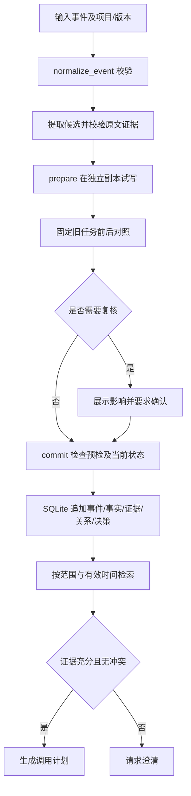

# MemoryGuard 仓库梳理

后续推进补记：以下梳理保留原 v0.2.0 状态；day1 新增 `memory_guard/llm.py`、`evaluation/day1.py` 与模型演示/材料脚本。最新实施状态见 `HANDOFF.md` 顶部，模型运行证据以 day1 的原始配置和响应为准。

梳理日期：2026-10-28（Asia/Shanghai）  
来源：https://github.com/H91111/MemoryGuard  
本地目录：`C:\memoryGuard`  
基线：`main` / `b5a3fed790bc6ed96a89dff6a1f8ea0874518440` / v0.2.0

## 1. 项目定位

MemoryGuard 是面向持续学习 Agent 的外部记忆治理库及本地工作台。它把原始事件转成带项目、版本、来源、原文证据和有效时间的事实，处理重复、冲突、授权纠错，再为任务提供受范围约束的上下文。

当前默认实现使用规则提取、字符 TF-IDF 检索和确定性工具规划器。持续学习指固定模型权重下的外部记忆适应；仓库没有实现模型参数训练。默认示例围绕登录 API，支持的事实属性为 `login_path`、`auth_field`、`timeout`、`retries`、`anonymous`。

核心价值是让新增知识的影响可见、可复核、可追溯。当前完成度适合本地演示、集成原型和合成回归；独立盲测、真实业务工具及生成模型效果仍需单独验证。

## 2. 技术栈与入口

| 层次 | 实现 | 入口 |
|---|---|---|
| 运行环境 | Python 3.11+，离线核心无第三方依赖 | `pyproject.toml` |
| 持久化 | 标准库 SQLite、事务、进程内 RLock | `memory_guard/store.py` |
| 输入提取 | 中文正则及原文片段校验；可选 Ollama | `memory_guard/extract.py` |
| 检索 | 字符 1/2/3-gram TF-IDF；可选 BGE 或混合排序 | `memory_guard/candidates.py` |
| 任务规划 | 确定性 login 调用计划，缺证或冲突时澄清 | `memory_guard/agent.py` |
| 学习影响 | 副本预检、提交门控、检查点比较及历史巡检 | `memory_guard/impact.py` |
| 本地服务 | ThreadingHTTPServer，仅绑定 127.0.0.1 | `memory_guard/server.py` |
| 前端 | 原生 HTML/CSS/JavaScript，无前端构建依赖 | `memory_guard/web/` |
| SDK | `from memory_guard import MemoryGuard` | `memory_guard/__init__.py` |
| 命令行 | `python -m memory_guard`；安装后为 `memory-guard` | `memory_guard/cli.py` |
| 启动 | Windows 启动脚本及 Python 启动器 | `启动工作台.cmd`、`start.ps1`、`scripts/launch.py` |

可选语义依赖见 `requirements-semantic.lock`，包括 torch、transformers 和 numpy。BGE 固定模型及 revision；模型不可用时不会默默用字符检索代替。Ollama 提取失败会保留原文并记录待复核。

## 3. 目录地图

```text
MemoryGuard/
├─ memory_guard/           核心 SDK、治理、检索、HTTP 服务、网页
├─ examples/               学习门控示例及独立模拟 API 工具
├─ tests/                  记忆治理、影响分析、会话及 HTTP 测试
├─ evaluation/             时序评测、负影响统计、独立答案标签
├─ data/                   dev/test 合成流、输入事件示例
├─ docs/                   产品指南、API、技术报告及交付记录
├─ scripts/                启动、环境记录、模型下载、打包、浏览器检查
├─ output/evaluation-v020/ 已提交的评测原始记录和汇总
├─ output/acceptance/      已提交的历史验收记录
├─ manifest.json           发布文件字节数与 SHA-256
└─ runtime/                本地数据库和本次验证输出；被 Git 忽略
```

`app.py` 直接调用服务，`__main__.py` 进入 CLI。网页启动默认使用 `runtime/memory.db`，旁边的 `.workspace.json` 保存会话注册信息；新会话使用独立数据库。首次创建工作台会加载六步演示。

## 4. 核心数据与运行流程



数据表包括 `meta`、`events`、`facts`、`evidence`、`relations`、`decisions`。事件按严格递增的 step 追加；重复 event_id 且输入相同可幂等返回，内容变化则拒绝。

同范围、同值、同有效时间关联新证据；同范围不同值保留冲突；不同项目、版本或不重叠有效时间可并存。授权纠错必须指定当前事实，满足范围和有效时间一致等条件，通过 `supersedes` 关系替代旧事实并保留历史。默认允许纠错的来源是本地构造配置中的 `maintainer`。

检查点表示已经观察到的事件前缀。`as_of` 表示业务事实的有效时间；观察时间与有效时间分别处理。冲突检测发生在排序和预算截断之前，避免检索预算隐藏冲突。上下文预算按 UTF-8 字节计量，名称中的 token 不代表实际模型 tokenizer 计数。

`prepare()` 固定一次提取结果并在副本中试写，比较调用保留、阻断、参数变化、恢复及持续不可用。`commit()` 校验预检内容摘要、当前状态摘要和确认标记，避免过期预检覆盖新状态，也避免随机提取器在提交时再次给出不同结果。

`fork()` 从检查点创建独立历史分支；`export()` / `replay()` 用于审计迁移和一致性检查。状态哈希用于内容一致性验证，不能等同于来源身份认证或数字签名。

## 5. 接口与产品边界

| 操作 | 主要入口 |
|---|---|
| 推荐的学习门控 | SDK `prepare` → 展示报告 → `commit` |
| 直接写入、纠错 | SDK `ingest` / `correct`；CLI `ingest` / `correct` |
| 查询计划 | SDK `run_agent`；CLI `query`；HTTP `/api/task` |
| 网页学习门控 | POST `/api/preview`、`/api/commit` |
| 状态、证据、历史 | `state`、`inspect`、`impact`、`fork` |
| 会话管理 | HTTP `/api/new-session`、`/api/switch-session` |
| 恢复与迁移 | `/api/restore`、`/api/export`、`/api/import` |

需要注意：

- 预检是可选治理入口。SDK/CLI 的 `ingest`、HTTP `/api/ingest` 和 `/api/correct` 等直接写入入口仍存在。需要强制门控的宿主应收敛写入接口，并由宿主配置来源身份与权限。
- 自动旧任务默认按已知项目/版本生成 login 探针；它不覆盖任意真实 Agent 的全部任务，也没有自动补齐所有业务有效时间。真实接入应通过 Python 接口提供代表性旧任务和必要的 `as_of`。
- 影响报告描述行为变化。参数变化可能是正确适应，冲突导致澄清也可能是正确防护；正确率需由独立工具或标签判断。
- 网页任务执行的是预置 Atlas/Beacon 模拟器。自定义项目没有规格时仅生成计划，不调用真实业务 API。
- HTTP 有 Host、Origin、自定义请求头和 CSP 检查；定位仍是单机单进程应用，没有多用户认证及公网部署能力。

## 6. 本次实际验证

验证使用本机 Codex 附带的 Python 3.12.14。没有安装可选模型依赖或下载模型，没有改动业务代码。

| 验证 | 结果 |
|---|---|
| `python -m unittest discover -s tests -v` | 44 项全部通过，约 5.5 秒 |
| `python -m examples.lifelong_agent` | 通过：识别新知识冲突，保留原调用 `/login` |
| 离线时序评测 | 8 条测试流、96 个事件、40 种常规任务内容，合计 480 次探针执行 |
| 治理更新动作 | 96/96 与预期一致 |
| 与已提交评测对照 | 三个方法的主要任务结果计数一致 |
| Git 原始文件与发布清单 | 67 个条目全部匹配 |

本次评测保存在 `runtime/review-20261028/evaluation/`，验证摘要为 `runtime/review-20261028/verification.json`。原有 `output/` 历史验收材料未被覆盖。

| 方法 | 可回答任务成功 | 不可回答时强答 | 多余澄清 | 旧任务成功 |
|---|---:|---:|---:|---:|
| B0 无跨任务记忆 | 0/88 | 0/56 | 88/88 | 0/48 |
| B2 同范围最近优先 | 70/88 | 8/56 | 18/88 | 48/48 |
| B3 规则治理 + 字符检索 | 88/88 | 0/56 | 0/88 | 48/48 |

480 次执行包含 432 次常规探针和 48 次诊断探针，不能当作 480 个独立问题。这些场景及标签均为开发者可见的自编合成数据，只能支持当前工程回归结论。本次未重跑浏览器视觉验收、BGE/Ollama 推理或真实 API 实验。

## 7. 当前可见的工程问题及建议顺序

1. **先统一 Git 换行与发布流程。** `.gitattributes` 要求 Python/JS/Markdown/JSON 等使用 LF，但部分 Git blob 实际保存 CRLF 或混合换行；Windows 本机 Git 同时开启 `core.autocrlf=true`。首次克隆即出现 26 个仅换行符差异的 tracked 文件，`git diff --ignore-space-at-eol --stat` 为空。本次工作目录另有 6 个文件与发布清单字节哈希不同，但 Git 原始 blob 全部匹配，且差异文件归一化换行后内容一致。建议单独提交换行规范化，并在最终发布字节确定后重新生成 manifest。本次没有将换行差异提交或批量修正。
2. **建立自动回归。** 当前检出未发现 `.github/workflows/`。可先加入 Python 3.11+、Windows/Linux 的 44 项测试和离线评测主要计数检查；将换行/打包完整性作为独立检查。
3. **收敛真实接入边界。** 如要求所有学习均需预检，应由集成层限制直接写入，明确调用者来源权限、人工确认流程、业务工具规格和旧任务集合。
4. **补独立评测。** 先用未参与规则开发的真实 API 文档变化构建留出集，再验证模型提取、语义检索与真实 Agent。分别记录错误强答、多余澄清、旧任务保留和适应收益。
5. **再验证规模与分发。** 当前预检会构建副本，历史巡检逐步重建分支，读取会装载事实及证据；应测更长事件流和更多证据下的耗时与内存。网页历史上限为 200 个事件，自动任务上限为 100 个范围。安装包场景也应单独验证评测数据和文档资源的可用性。

## 8. 开发与阅读路线

建议按 `schema.py` → `extract.py` → `store.py` → `agent.py` → `impact.py` → `workspace.py` → `server.py` → `web/app.js` 阅读；先看 `tests/test_memory.py` 理解治理规则，再看 `test_impact.py` 和 `test_server.py` 理解产品行为。

有 Python 3.11+ 的环境可从项目根目录运行：

```powershell
python -m unittest discover -s tests -v
python -m examples.lifelong_agent
python -m memory_guard evaluate --out runtime/my-evaluation
powershell -File start.ps1 -Port 8765
```

随后访问 `http://127.0.0.1:8765`。此环境的 PATH 中只发现 WindowsApps 的 `python.exe` 入口，本次验证实际使用下面的解释器；如默认启动脚本无法找到 Python，可在项目根目录直接运行：

```powershell
& 'C:\Users\WuHoo\.cache\codex-runtimes\codex-primary-runtime\dependencies\python\python.exe' -X utf8 -m scripts.launch --port 8765
```

产品操作读 `docs/product-guide.md`，SDK 与模型接入读 `docs/api.md`，研究口径读 `docs/technical-report.md` 和 `evaluation/configs/protocol.md`。本梳理新增文档未更新发布 manifest，重新发布时须运行并复核发布流程。
